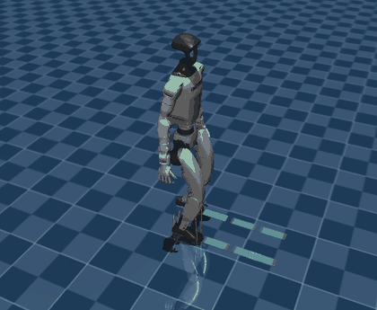
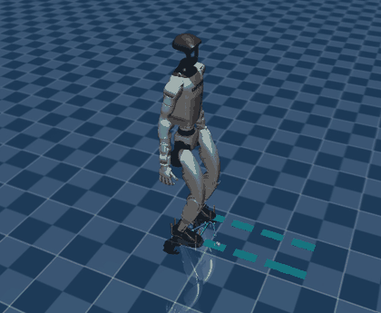
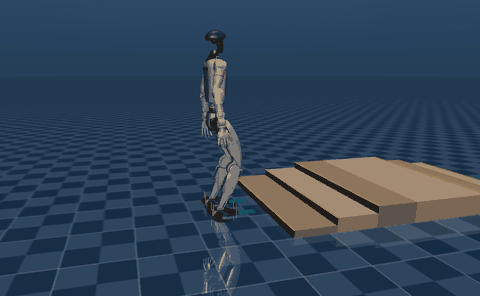
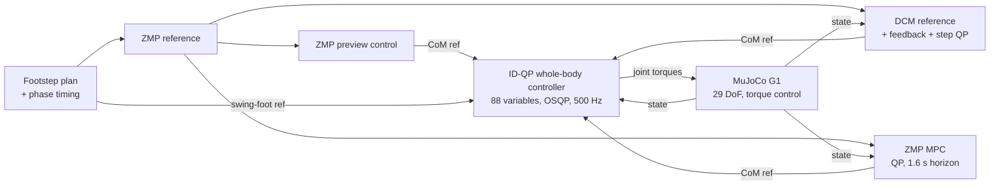
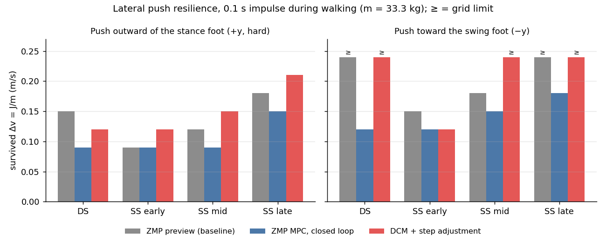

# Unitree G1 Humanoid: Whole-Body Control and Walking from Scratch

Model-based locomotion for the 29-DoF Unitree G1 humanoid in MuJoCo, written from first principles in Python:
an inverse-dynamics QP whole-body controller, ZMP preview walking, stair climbing, DCM / capture-point push
recovery with online step adjustment, and a linear ZMP model-predictive controller. It also includes a benchmark
that measures how hard a push each controller survives.

No control framework is used. The dynamics come straight from MuJoCo (`mj_fullM`, `qfrc_bias`, Jacobians),
and every optimization problem is assembled by hand and solved with OSQP.

| Push recovery (DCM + step adjustment) | Walking with ZMP MPC | Stairs, 3 up / 3 down |
|:---:|:---:|:---:|
|  |  |  |
| −40 N for 0.15 s in single support; the landing point moves 13 cm sideways | Predicted ZMP (green) and CoM (blue) over the 1.6 s horizon | 5 cm risers, step-to gait, 2× speed |

## What is in here

- **Whole-body controller: inverse-dynamics QP** ([`sim/idqp_core.py`](sim/idqp_core.py), derivation in [`idqp_formulation.md`](idqp_formulation.md))
  - Decision variables: joint accelerations, joint torques and contact forces, `x = [q̈ (35) | τ (29) | f (24)]`.
  - Weighted tasks: CoM, torso and pelvis orientation, swing foot, posture.
  - Hard constraints: floating-base dynamics, stance feet held in place, torque limits, linearized friction cones, joint limits.
  - When the QP is infeasible, OSQP's primal-infeasibility (Farkas) certificate is used to report which constraint groups conflict.
- **Walking: ZMP preview control** ([`sim/walk_core.py`](sim/walk_core.py))
  - Pipeline: footstep plan → ZMP reference → cart-table preview control (Kajita 2003) → CoM and swing-foot trajectories → ID-QP.
  - The contact set of the ID-QP changes with the gait phase.
- **Stairs** ([`sim/stairs_core.py`](sim/stairs_core.py))
  - Step-to gait with a piecewise-LIPM CoM height plan.
  - A single terrain object builds both the MuJoCo scene and the planner's queries (tread height, edge distance), so the two cannot disagree.
- **DCM / capture-point control with step adjustment** ([`sim/dcm_core.py`](sim/dcm_core.py))
  - Closed-form DCM reference, integrated backward from the end of the plan, exact for the polynomial ZMP.
  - DCM error feedback through the commanded CoP.
  - A small QP that splits the correction between the CoP and the landing point of the swing foot.
- **Linear ZMP MPC** ([`sim/mpc_core.py`](sim/mpc_core.py))
  - The QP is condensed over the horizon, with jerk as the input (Wieber 2006).
  - Hard constraints: the ZMP stays inside the support polygon at every sample, and a terminal DCM constraint is applied.
  - An offline self-check compares the matrices against the closed form and against preview control.
- **Benchmark and tooling**
  - Push sweeps and a resilience benchmark: [`sim/sweep_g1_push.py`](sim/sweep_g1_push.py), [`sim/resilience_g1.py`](sim/resilience_g1.py).
  - A shared runner with a live viewer, on-floor markers (CoM, CoP, capture point, support polygon, forces), event detection (touchdown, slip, scuffing, saturation, infeasibility), `.npz` logs, plots and a PASS/FAIL report for every run.

## Architecture



Only the torques τ from the QP are applied to the robot. The predicted accelerations and contact forces are logged
and used to check the model against the simulator, for example the commanded CoP against the measured CoP.

## Results

All results are from MuJoCo with a 2 ms control step and the full robot model. They were measured with the scripts in `sim/`.

**Flat walking: 8 steps of 10 cm, 0.5 s single support, 0.2 s double support**

| Controller | Steps | Infeasible ID-QPs | Max DCM tracking error | Peak torque / limit |
|---|---|---|---|---|
| DCM feedback + step adjustment | 8 / 8 | 0 | 15.4 mm | 0.52 |
| ZMP MPC, closed loop (2.8 ms per MPC solve) | 8 / 8 | 0 | 12.1 mm | 0.54 |

**Stairs: 3 up, landing, 3 down, 30 cm treads**

| Riser | Result |
|---|---|
| 5 cm | 20 / 20 touchdowns, 0 infeasible QPs, no scuffing, sole at least 58 mm from every edge, peak torque 0.80 of the limit |
| 8 cm and 10 cm | Not solved yet: the robot falls (see the limitations below) |

**Push resilience**

A 0.1 s lateral impulse is applied to the torso during step 4, at four gait phases.
The value reported is the largest impulse J such that every smaller J on the grid was survived, given as Δv = J/m.



- Worst case over all phases and directions: preview **0.09 m/s**, closed-loop MPC **0.09 m/s**, DCM with step adjustment **0.12 m/s**.
- In a separate sweep with a 0.15 s push in single support, preview survives −40 N to +20 N and DCM with step adjustment survives −50 N to +30 N.

## Engineering notes

These are findings from debugging and measurement. Each one changed a design decision.

- **The CoP command margin must be zero.**
  - A 1 cm safety inset on the commanded CoP removed 40 % of the ±25 mm lateral sole width.
  - It also stopped the multi-body robot from using its hips, so the DCM controller fell even under ±20 N.
  - With no inset and a stiffer error gain (k = 6 s⁻¹ instead of 3), the controller survives −50 N to +30 N.
- **CoP and CMP are not the same point.**
  - The logs show up to 66 mm between the commanded CoP and the measured CoP, caused by centroidal angular momentum that the LIPM ignores.
  - This mismatch is the main limit of every reduced-model controller here, and the reason for the next step on the roadmap.
- **MPC sampling time.**
  - With T = 0.1 s the double-support phase (0.2 s) gets only two samples. The ZMP then crosses phase boundaries between samples and leaves the sole by 15 mm.
  - T = 0.05 s with N = 32 keeps the same 1.6 s horizon and removes the violation.
- **A terminal constraint is needed.**
  - Without it, the predicted DCM at the end of the horizon drifts up to 47 cm from the reference. The divergent mode is "free" inside the horizon.
- **Closed-loop MPC is weaker than open loop on the real multi-body robot.**
  - Re-planning from the measured CoM every 20 ms removes the error that the whole-body CoM PD loop uses. Recovery is then limited to what the LIPM allows, with the ZMP inside the foot.
  - The same MPC run open loop matches the preview baseline: it survives ≥ 8 N·s instead of 4 N·s when pushed in double support.

## Repository layout

```
sim/
  idqp_core.py        ID-QP whole-body controller (balance), solver diagnostics
  walk_core.py        ZMP preview walking on top of the ID-QP
  stairs_core.py      stair climbing (step-to gait, piecewise LIPM)
  dcm_core.py         DCM feedback + step adjustment
  mpc_core.py         linear ZMP MPC (run it directly for the offline self-check)
  idqp_monitor.py     robot state, events, logger, viewer markers
  run_g1_*.py         runners: viewer or headless, video, PASS/FAIL report
  sweep_g1_push.py, resilience_g1.py   push benchmarks
  plot_g1_*.py        plots from the logs
idqp_formulation.md   QP formulation: tasks, constraints, KKT and OSQP (Vietnamese)
cartpole_control/     earlier stage: dynamics, LQR, energy-based swing-up
PLANS.md              learning roadmap and next steps (Vietnamese)
third_party/          Unitree G1 model, cloned separately (see Running; not in the repo)
```

## Running

```bash
python3 -m venv .venv && source .venv/bin/activate
pip install -r requirements.txt      # mujoco 3.x, numpy, scipy, osqp, matplotlib, imageio

# robot model: only the unitree_g1 folder of MuJoCo Menagerie is needed
git clone --depth 1 --filter=blob:none --sparse https://github.com/google-deepmind/mujoco_menagerie.git third_party/mujoco_menagerie
git -C third_party/mujoco_menagerie sparse-checkout set unitree_g1

python sim/run_g1_walk.py                                   # ZMP preview walking, live viewer
python sim/run_g1_dcm.py --push --push-f -40                # DCM push recovery
python sim/run_g1_mpc.py                                    # ZMP MPC
python sim/run_g1_stairs.py                                 # stairs, 5 cm risers
python sim/run_g1_dcm.py --headless --video --push --tag _push    # headless: report, log and mp4 in out/
python sim/resilience_g1.py --controllers preview dcm_step mpc    # push benchmark (about 12 min on 8 cores)
```

The model path defaults to `third_party/mujoco_menagerie/unitree_g1/scene.xml`. Set `G1_XML` to use another model.

## Limitations and next steps

- **Stairs with 8 cm risers and above** still fail: the CoM height transitions and knee torque need work.
- **Reduced models:** none of the walking controllers models centroidal angular momentum yet.
- **Fixed step timing:** pushes outward of the stance foot early in single support need step-timing adaptation.

Planned next steps, in order:
1. MPC with partial state feedback.
2. MPC as the reference, with DCM feedback underneath.
3. Footstep positions as MPC decision variables (Herdt 2010).
4. Centroidal MPC.
5. An RL policy in MuJoCo, compared on the same resilience benchmark.

## References

- S. Kajita et al., *Biped walking pattern generation by using preview control of zero-moment point*, ICRA 2003
- P.-B. Wieber, *Trajectory free linear model predictive control for stable walking in the presence of strong perturbations*, Humanoids 2006
- J. Pratt et al., *Capture point: a step toward humanoid push recovery*, Humanoids 2006
- J. Englsberger, C. Ott, A. Albu-Schäffer, *Three-dimensional bipedal walking control based on divergent component of motion*, IEEE T-RO 2015
- A. Herdt et al., *Online walking motion generation with automatic footstep placement*, Advanced Robotics 2010
- R. Tedrake, *Underactuated Robotics*, MIT 6.832
- Robot model: Unitree G1 from [MuJoCo Menagerie](https://github.com/google-deepmind/mujoco_menagerie). See its license in `third_party/`.
